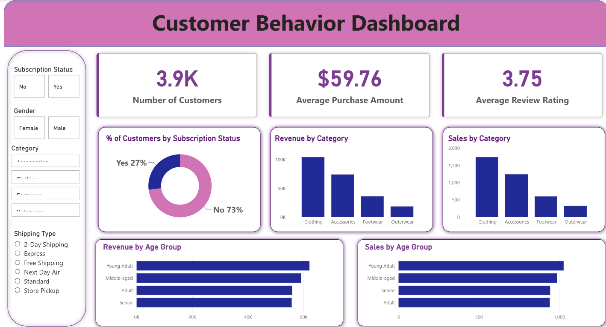

# Customer Trend Analysis

An end-to-end customer shopping behavior analysis project. It takes a retail
shopping dataset from initial exploration and preparation in Python through
SQL analysis and a Power BI dashboard, with the goal of turning purchase
patterns into testable business questions.

## Project at a glance

- **Dataset:** 3,900 shopping records and 18 original columns
- **Workflow:** Python / pandas → PostgreSQL → SQL → Power BI
- **Focus areas:** customer segments, spending, discounts, products, shipping,
  subscriptions, and demographics
- **Audience:** recruiters, data analytics learners, and anyone reviewing the
  analysis workflow

## Repository contents

| File | Purpose |
|---|---|
| `Business Problem  Document.pdf` | States the business problem and expected analysis deliverables |
| `customer_shopping_behavior.csv` | Source dataset used by the notebook |
| `Customer_Shopping_Behavior_Analysis.ipynb` | Explores and prepares the data, then loads it into PostgreSQL |
| `customer_behavior_sql_queries.sql` | Ten SQL queries for investigating the business questions |
| `customer_behavior_dashboard.pbix` | Power BI dashboard with summary cards, charts, and filters |
| `public/customer-behavior-dashboard.png` | Screenshot preview of the Power BI dashboard |

## Analysis workflow

1. **Load and inspect the source data.** The notebook reads the CSV with pandas
   and checks sample rows, data types, descriptive statistics, and missing
   values. The source has 37 missing values in `Review Rating`; the other 17
   columns have no missing values.
2. **Prepare the data.** It fills those 37 missing review ratings with the
   median rating for each record's product category, converts column names to
   snake case, renames the purchase amount column, creates age groups and a
   purchase-frequency-in-days field, and drops `promo_code_used` after checking
   that it matches `discount_applied` in the data.
3. **Load the prepared data into PostgreSQL.** The notebook writes the DataFrame
   to a table named `customer` in the configured database.
4. **Investigate business questions with SQL.** The SQL file compares revenue
   and purchase patterns across customer, product, discount, shipping, and
   subscription groups.
5. **Explore the results in Power BI.** The dashboard includes customer and
   purchase summary cards, subscription and category visuals, age-group
   comparisons, and filters for subscription status, gender, category, and
   shipping type.

## Dashboard preview



## Verified observations

The figures below are calculated from the checked-in CSV. They describe this
dataset; they do not establish that one factor caused another.

- **Revenue by gender:** male records account for $157,890 (about 67.7% of
  recorded revenue); female records account for $75,191 (about 32.3%).
- **Discounts and higher purchases:** 839 records have a discount and a
  purchase amount at or above the dataset average of about $59.76. Their
  average purchase amount is about $79.79.
- **Average purchase amount by shipping type:** Express is about $60.48 and
  Standard is about $58.46. In this dataset, that is roughly a 3.4% difference,
  not 12%.
- **Subscription comparison:** subscription records average about $59.49 per
  purchase, compared with about $59.87 for non-subscription records.
  Subscription records account for about 26.9% of recorded revenue.
- **Highest average review ratings by product:** after applying the notebook's
  category-median imputation, the top five are Gloves (3.86), Sandals (3.84),
  Boots (3.82), Hat (3.80), and Skirt (3.78), out of 5.

The SQL file's customer segmentation query labels records with
`previous_purchases = 1` as **New**, 2–10 as **Returning**, and all higher
values as **Loyal**. Applied to this CSV, that produces approximately 2.1% New,
18.0% Returning, and 79.9% Loyal. These labels should be reviewed before using
them for business decisions: the dataset's `previous_purchases` values start
at 1, and the query treats every value above 10 as Loyal.

## Run the workflow

### Requirements

- Python and Jupyter Notebook
- Python packages: `pandas`, `SQLAlchemy`, and `psycopg2-binary`
- A running PostgreSQL server and a database you can write to
- Power BI Desktop to open or refresh the `.pbix` dashboard

Install the notebook's Python dependencies:

```powershell
python -m pip install pandas sqlalchemy psycopg2-binary
```

### Prepare and load the data

1. Open `Customer_Shopping_Behavior_Analysis.ipynb` from this project folder so
   its relative CSV path resolves.
2. Set the PostgreSQL connection values in the environment where Jupyter will
   run. For example, in PowerShell:

   ```powershell
   $env:DB_USERNAME = "your_username"
   $env:DB_PASSWORD = "your_password"
   $env:DB_HOST = "localhost"
   $env:DB_PORT = "5432"
   $env:DB_DATABASE = "your_database"
   ```

3. Run the notebook cells in order. The final PostgreSQL cell writes the
   prepared data to the `customer` table, replacing that table if it already
   exists.

Keep real credentials out of notebooks and version control. The notebook builds
its database URL from environment variables; if your password contains URL
special characters, ensure it is URL-encoded or update the connection code to
use SQLAlchemy's structured URL helper.

### Run the SQL analysis

Open `customer_behavior_sql_queries.sql` in a PostgreSQL client connected to
the database used by the notebook, then run the queries. They cover:

1. Revenue by gender
2. Discounted purchases at or above average spend
3. Top products by average rating
4. Average purchase amount by Standard and Express shipping
5. Purchase counts, average spend, and revenue by subscription status
6. Products with the highest discount rates
7. New, Returning, and Loyal segments based on previous purchases
8. Top three products within each category
9. Subscription status among repeat buyers
10. Revenue by age group

The queries use PostgreSQL syntax. In particular, the product-rating query
casts ratings using PostgreSQL's `::numeric` notation.

### Open the dashboard

Open `customer_behavior_dashboard.pbix` in Power BI Desktop. To refresh it from
your own database, use the PostgreSQL connection for the same database/schema
and table populated by the notebook (`public.customer` by default), then
refresh the model.

## Interpretation and limitations

- The dataset has purchase-frequency labels and a season field, but no
  transaction dates or online/offline channel column. It therefore cannot
  support a time-based trend analysis or an online-versus-offline comparison.
- Group differences are descriptive, not proof of cause. For example, the
  subscription and shipping comparisons do not control for other factors.
- Customer segments and counts follow the definitions in the SQL query; review
  those definitions before presenting them as business-ready customer
  categories.
- The PDF describes a report and presentation as intended deliverables, but
  separate report and presentation files are not included in this repository.

## License

No license is specified in this repository. Add a `LICENSE` file before
redistributing the project under a particular license.